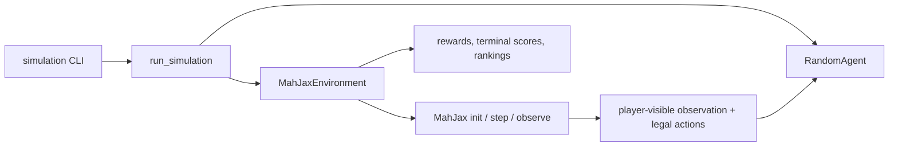

# Architecture

`src/mahjong/environment.py` encapsulates MahJax configuration, PRNG-key splitting, resets, transitions, legal-action validation, and player-visible observations. It is the only module that depends on MahJax's environment calls. Raw state is available only for diagnostics and must never be supplied to a policy, because it contains hidden information.

`src/mahjong/agents/random_agent.py` chooses from a supplied legal-action sequence using its own seeded Python generator. It has no environment-state access. `src/mahjong/simulation.py` coordinates four random agents and aggregates only returned rewards plus terminal data exposed by MahJax. `src/mahjong/utils/device.py` reports the JAX runtime without assuming a GPU.

Randomness has two streams: JAX PRNG keys drive MahJax initialization and stepping, while one seeded `RandomAgent` per player selects legal actions. A simulation base seed deterministically derives both streams.

Future PPO, reward-risk transformations, and CVaR estimators should consume this adapter's transition interface or a separately tested batched version. A future training policy must retain the same restriction to observations and legal masks.
